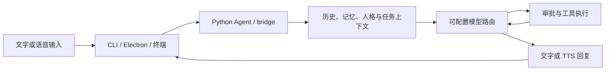

# 功能与架构

## 执行链路

语音输入由 ASR 转写，Agent 组装上下文并向模型请求回答或工具调用。执行结果再回传模型，任务与记忆存储在 SQLite；语音回复经过 TTS。硬件终端通过 `/ws/device` 把录音交给 PC 端处理。

## 模块对应

| 模块 | 主要职责 | 代码 |
|---|---|---|
| 对话入口 | ask、chat、voice、bridge、管理命令 | `src/jarvis/cli.py` |
| 智能体 | 多轮工具调用、回复与上下文衔接 | `src/jarvis/agent.py` |
| 模型路由 | 不同任务角色、回退和预算 | `src/jarvis/runtime/router.py`、`budget.py` |
| 记忆与知识 | SQLite、FTS、知识切块和可选 embedding | `memory.py`、`learning.py`、`runtime/semantic_memory.py` |
| 任务运行 | 任务状态、计划、执行、取消与继续 | `runtime/tasks.py`、`execution.py`、`planner.py` |
| 工具 | 天气、网页、文件、系统、桌面动作 | `tools.py`、`runtime/desktop.py` |
| 浏览器与视觉 | 可选交互浏览器、截图/图像理解 | `runtime/browser.py`、`vision.py` |
| 语音 | ASR 提供者、流式识别、回复与 TTS | `asr_provider.py`、`streaming_asr.py`、`voice.py`、`bridge.py` |
| 桌面 | Electron 窗口、托盘、唤醒、运行面板 | `ashley-upstream/src` |
| 设备通道 | 设备连接、录音、状态和音频回传 | `device_channel.py`、`terminal/lisa_client` |
| 扩展与运维 | MCP、插件、日志、备份、配置与更新接口 | `runtime/mcp.py`、`production/` |

## 能力边界

- 本地记忆和可选本地 ASR 已有实现；选择云模型或 Edge TTS 后仍需网络。
- 桌面控制包含 Windows 专用实现，跨平台能力不同。
- 文档分析支持基础文本提取。CSV/DOCX/XLSX/PPTX 不等于完整排版理解；PDF 路径需额外的 pypdf。
- MCP 与插件是扩展接口，仓库不自动安装第三方服务。
- LoRA 是独立实验路线，不是启动基础聊天的前置条件；仓库不分发适配器权重。
- 更新与签名有代码入口，公开自动更新服务和正式签名发布流程尚未建立。

运行效果以实际模型、配置和环境为准；本次验证见 [VALIDATION.md](VALIDATION.md)。
